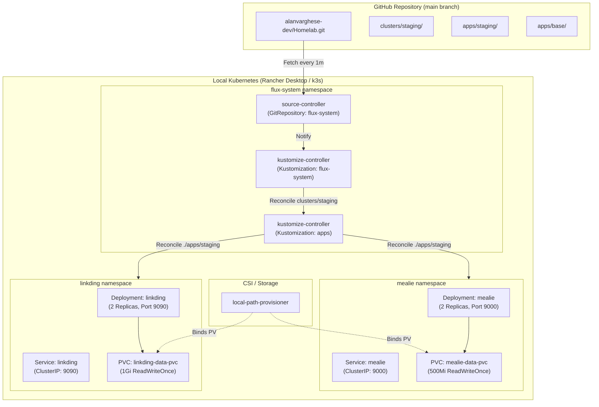

# 🏠 Kubernetes Homelab

[](https://kubernetes.io/)
[](https://fluxcd.io/)
[](https://kustomize.io/)
[-0075A8?style=flat&logo=suse&logoColor=white)](https://rancherdesktop.io/)
[](https://devpod.sh/)
[](https://mise.jdx.dev/)

A declarative, GitOps-driven homelab engineered for **Kubernetes experimentation, self-hosting, and infrastructure automation**. Built with **Flux CD (v2)** continuously reconciling state directly from Git, orchestrated locally on **Rancher Desktop (k3s)**, and developed inside reproducible **DevPod** containers.

---

> **🎯 Purpose**: Provide a zero-drift, declarative sandbox for hosting self-hosted utilities, testing cloud-native networking, and mastering production-grade GitOps workflows locally with a seamless path to cloud infrastructure.

---

## 📑 Table of Contents

- [Architecture Overview](#-architecture-overview)
- [Deployed Applications](#-deployed-applications)
  - [1. Linkding (Bookmarks Manager)](#1-linkding-bookmarks-manager)
  - [2. Mealie (Recipe Manager & Meal Planner)](#2-mealie-recipe-manager--meal-planner)
- [Repository Structure](#-repository-structure)
- [GitOps Architecture (Flux CD)](#-gitops-architecture-flux-cd)
- [Quickstart & Environment Setup](#-quickstart--environment-setup)
- [Accessing the Applications](#-accessing-the-applications)
- [Day-2 Operations & Flux CLI Cheatsheet](#-day-2-operations--flux-cli-cheatsheet)
- [Adding New Applications](#-adding-new-applications)
- [Workload Security Standards](#-workload-security-standards)
- [Roadmap & Next Steps](#-roadmap--next-steps)

---

## 🏗 Architecture Overview



---

## 📦 Deployed Applications

Currently, two applications are deployed to the cluster under declarative GitOps management using Kustomize bases and environment overlays:

| Application | Namespace | Image | Replicas | Service Port | PVC Size | Mount Path | Purpose |
| :--- | :--- | :--- | :---: | :---: | :---: | :--- | :--- |
| **[Linkding](apps/base/linkding/README.md)** | `linkding` | `sissbruecker/linkding:1.31.0` | `2` | `9090/TCP` | `1Gi` | `/etc/linkding/data` | Self-hosted, lightweight bookmark manager with archiving and tagging |
| **[Mealie](apps/base/mealie/README.md)** | `mealie` | `ghcr.io/mealie-recipes/mealie:v1.3.0` | `2` | `9000/TCP` | `500Mi` | `/app/data` | Recipe manager, meal planner, and automatic recipe scraper |

### 1. Linkding (Bookmarks Manager)
- **Features**: Fast bookmarking, automated webpage archival, tagging, search, browser extension support.
- **Manifests**: Defined under [`apps/base/linkding/`](apps/base/linkding/) and staged via [`apps/staging/linkding/`](apps/staging/linkding/).
- **Security**: Runs unprivileged with `runAsUser: 33` (`www-data`), `runAsGroup: 33`, `fsGroup: 33`, and `allowPrivilegeEscalation: false`.
- **Docs**: Read the detailed [Linkding Application Guide](apps/base/linkding/README.md).

### 2. Mealie (Recipe Manager & Meal Planner)
- **Features**: Automatic recipe scraping from URLs, interactive shopping lists, meal planning calendar, multi-user support.
- **Manifests**: Defined under [`apps/base/mealie/`](apps/base/mealie/) and staged via [`apps/staging/mealie/`](apps/staging/mealie/).
- **Security**: Runs with non-root security context `runAsUser: 33` (`www-data`), `runAsGroup: 33`, `fsGroup: 33`, and `allowPrivilegeEscalation: false`.
- **Docs**: Read the detailed [Mealie Application Guide](apps/base/mealie/README.md).

---

## 📁 Repository Structure

```text
.
├── .devcontainer/                             # Reproducible DevPod environment configuration
│   ├── devcontainer.json                      # DevContainer config (binds host Docker socket)
│   └── Dockerfile                             # Ubuntu 26.04 image with Mise pre-configured
├── apps/                                      # Application manifests (Base + Overlays)
│   ├── README.md                              # Application onboarding & architecture guide
│   ├── base/                                  # Common Kustomize application bases
│   │   ├── linkding/                          # Linkding base manifests (Deployment, Svc, PVC, NS)
│   │   │   ├── deployment.yaml
│   │   │   ├── kustomization.yaml
│   │   │   ├── namespace.yaml
│   │   │   ├── service.yaml
│   │   │   ├── storage.yaml
│   │   │   └── README.md
│   │   └── mealie/                            # Mealie base manifests (Deployment, Svc, PVC, NS)
│   │       ├── deployment.yaml
│   │       ├── kustomization.yaml
│   │       ├── namespace.yaml
│   │       ├── service.yaml
│   │       ├── storage.yaml
│   │       └── README.md
│   ├── staging/                               # Staging environment overlays
│   │   ├── linkding/kustomization.yaml        # References ../../base/linkding/
│   │   └── mealie/kustomization.yaml          # References ../../base/mealie/
│   └── production/                            # Production environment overlays (future)
│       └── linkding/
├── clusters/                                  # Flux CD cluster roots
│   ├── README.md                              # Flux CD cluster structure guide
│   ├── staging/                               # Active staging cluster definition
│   │   ├── apps.yaml                          # Flux Kustomization targeting ./apps/staging
│   │   └── flux-system/                       # Flux controllers & cluster Git sync
│   │       ├── gotk-components.yaml           # Flux operator components (Toolkit v2)
│   │       ├── gotk-sync.yaml                 # GitRepository and root cluster Kustomization
│   │       └── kustomization.yaml
│   └── production/                            # Production cluster entrypoint (reserved)
├── infrastructure/                            # Core cluster infrastructure dependencies
│   ├── configs/                               # Cluster-wide configs (staging/prod/base)
│   └── controllers/                           # Ingress, cert-manager, external-dns, etc.
├── monitoring/                                # Observability stack
│   ├── configs/                               # Dashboards, PrometheusRule alerts, scrapes
│   └── controllers/                           # Prometheus, Grafana, Loki (reserved)
├── docs/                                      # Extended documentation and architecture notes
├── mise.toml                                  # Tool versioning configuration (helm, kubectl, flux, etc.)
└── README.md                                  # Homelab main documentation (this file)
```

---

## 🔄 GitOps Architecture (Flux CD)

The cluster state is continuously driven by Flux CD using two primary synchronization layers:

```
GitRepository (flux-system) -> clusters/staging/flux-system/gotk-sync.yaml
  │
  ├── 1. Kustomization (flux-system) -> watches ./clusters/staging (interval: 10m)
  │      └── Syncs flux-system and registers apps.yaml
  │
  └── 2. Kustomization (apps) -> watches ./apps/staging (interval: 1m, prune: true)
         └── Discovers and reconciles all application overlays (linkding, mealie)
```

### Self-Healing & Drift Detection
- If any manifest in `./apps/staging` is modified, pushed, or reverted in Git, Flux reconciles the cluster state within **1 minute**.
- If a resource in the cluster is manually altered or deleted with `kubectl`, Flux detects the drift and restores the declarative state defined in Git.
- `prune: true` ensures that when an application or resource is removed from Git, Flux automatically garbage-collects the corresponding Kubernetes resource.

---

## 🚀 Quickstart & Environment Setup

### 1. Prerequisites
- **Host Engine**: [Rancher Desktop](https://rancherdesktop.io/) running Kubernetes (k3s) with the `dockerd` (moby) runtime.
- **Dev Workspace**: [DevPod](https://devpod.sh/) or VS Code Remote Containers.
- **CLI Manager**: [Mise](https://mise.jdx.dev/) for managing local tool versions.

### 2. Starting the Dev Environment
Launch the workspace using DevPod, which automatically mounts the host Docker socket `/var/run/docker.sock` and installs required CLI utilities:

```bash
# Launch DevPod container
devpod up .
```

Or install the CLI toolchain directly on macOS/Linux using Mise:
```bash
# Installs kubectl, flux2, helm, kubens, kubectx, gh
mise install
```

### 3. Verify Cluster Connectivity
Ensure your kubeconfig is pointing to the Rancher Desktop cluster:
```bash
kubectl get nodes
kubectl get pods -A
```

### 4. Verify Flux CD GitOps Sync
Check the status of the Flux synchronization:
```bash
flux get kustomizations
flux get sources git
```

You should see both `flux-system` and `apps` reporting `Ready: True`:
```text
NAME           REVISION          SUSPENDED  READY  MESSAGE
apps           main@sha1:xxxxxx  False      True   Applied revision: main@sha1:xxxxxx
flux-system    main@sha1:xxxxxx  False      True   Applied revision: main@sha1:xxxxxx
```

---

## 🌐 Accessing the Applications

Because the applications currently use `ClusterIP` services, use `kubectl port-forward` to access them locally on your browser:

### Linkding (Bookmarks)
Forward port `9090`:
```bash
kubectl port-forward -n linkding svc/linkding 9090:9090
```
Open **[http://localhost:9090](http://localhost:9090)** in your browser.

> [!TIP]
> **First-time Linkding Setup**: Create your initial superuser by running:
> ```bash
> kubectl exec -it -n linkding deploy/linkding -- python manage.py createsuperuser
> ```

---

### Mealie (Recipe Manager)
Forward port `9000`:
```bash
kubectl port-forward -n mealie svc/mealie 9000:9000
```
Open **[http://localhost:9000](http://localhost:9000)** in your browser.

---

## 🛠 Day-2 Operations & Flux CLI Cheatsheet

### Check Status & Reconcile
```bash
# View all Flux resources across the cluster
flux get all -A

# Force an immediate sync from Git
flux reconcile source git flux-system

# Force immediate reconciliation of the application workloads
flux reconcile kustomization apps --with-source
```

### Inspect Pods & Workloads
```bash
# View Linkding resources
kubectl get svc,pvc,deployment,pods -n linkding

# View Mealie resources
kubectl get svc,pvc,deployment,pods -n mealie

# Tail logs for Mealie
kubectl logs -n mealie -l app=mealie -f

# Tail logs for Linkding
kubectl logs -n linkding -l app=linkding -f
```

### Inspect Storage & PVCs
```bash
# Check PVC bound status and allocated volume
kubectl get pvc -n linkding
kubectl get pvc -n mealie
```

---

## ➕ Adding New Applications

Adding a new application to this homelab follows a standard GitOps pattern:

1. **Create the Base Directory**:
   Create `apps/base/<app-name>/` containing:
   - `namespace.yaml`
   - `deployment.yaml`
   - `service.yaml`
   - `storage.yaml` (if persistent storage is required)
   - `kustomization.yaml` (listing the above resources)

2. **Create the Environment Overlay**:
   Create `apps/staging/<app-name>/kustomization.yaml`:
   ```yaml
   apiVersion: kustomize.config.k8s.io/v1beta1
   kind: Kustomization
   resources:
     - ../../base/<app-name>/
   ```

3. **Verify Locally with Kustomize**:
   ```bash
   kubectl kustomize apps/staging/<app-name>
   ```

4. **Commit & Push to Git**:
   Push the changes to the `main` branch. Flux CD will detect the new directory in `./apps/staging` and automatically deploy the application.

---

## 🔒 Workload Security Standards

All homelab workloads adhere to baseline container security best practices:

- **Non-Root Execution**: Pods run under non-privileged service accounts (`runAsUser: 33`, `runAsGroup: 33`, `fsGroup: 33` for `www-data`).
- **Privilege Escalation Blocked**: `allowPrivilegeEscalation: false` is enforced on all container specs.
- **Namespace Isolation**: Each application lives in its own dedicated namespace (`mealie`, `linkding`) rather than polluting `default`.
- **Persistent Volume Security**: PVCs request explicit storage sizing (`500Mi` - `1Gi`) using `ReadWriteOnce` access mode bound to `local-path`.

---

## 🗺 Roadmap & Next Steps

- [x] Initial repository structure and DevPod containerization
- [x] Rancher Desktop (k3s) local Kubernetes cluster setup
- [x] Bootstrap Flux CD v2 GitOps engine
- [x] Deploy Linkding bookmark manager with persistent storage via Flux
- [x] Deploy Mealie recipe manager with persistent storage via Flux
- [ ] Configure Ingress controller (Traefik or Ingress-NGINX) with local domain routing (e.g. `*.homelab.local`)
- [ ] Implement TLS certificate automation with `cert-manager`
- [ ] Add encrypted secrets management (SOPS / Sealed Secrets)
- [ ] Set up Prometheus & Grafana monitoring stack under `monitoring/`
- [ ] Provision production cloud cluster (Azure AKS) via Terraform
