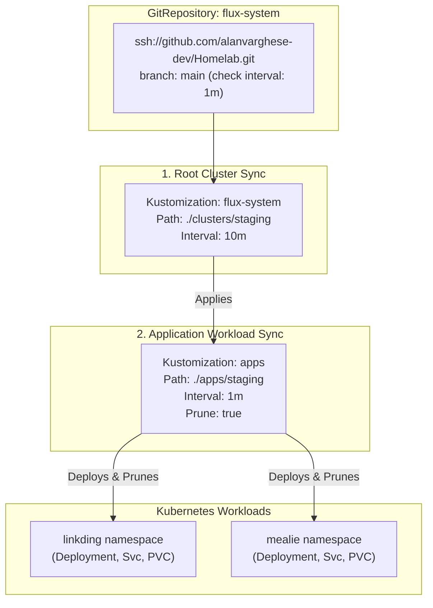

# ☸️ Clusters Directory (`clusters/`)

This directory contains the root GitOps configuration entrypoints for **Flux CD (v2)**. Flux uses the manifests defined here to bootstrap itself, declare sources (Git repositories), and continuously synchronize target directories into each cluster environment.

---

## 🏗 Directory Architecture

```text
clusters/
├── README.md                      # This documentation guide
├── staging/                       # Active local staging cluster (Rancher Desktop / k3s)
│   ├── apps.yaml                  # Flux Kustomization pointing to ./apps/staging
│   └── flux-system/               # Core Flux CD system manifests
│       ├── gotk-components.yaml   # Flux controller components (Toolkit v2)
│       ├── gotk-sync.yaml         # GitRepository source & root cluster sync Kustomization
│       └── kustomization.yaml     # Kustomize manifest aggregating gotk-* files
└── production/                    # Production cloud cluster (Azure AKS / reserved)
```

---

## 🔄 Flux CD Sync Hierarchy

Flux synchronizes the staging environment using a layered two-tier architecture:



### 1. Root Cluster Sync (`clusters/staging/flux-system/gotk-sync.yaml`)
- **`GitRepository/flux-system`**: Polls the `main` branch of `ssh://github.com/alanvarghese-dev/Homelab.git` every 1 minute.
- **`Kustomization/flux-system`**: Applies the `./clusters/staging` path every 10 minutes to maintain core GitOps infrastructure.

### 2. Application Workload Sync (`clusters/staging/apps.yaml`)
- **`Kustomization/apps`**: Watches `./apps/staging` with an interval of 1 minute and `prune: true`.
- Automatically discovers and synchronizes all application overlays (`apps/staging/linkding`, `apps/staging/mealie`).
- Ensures automatic deletion (pruning) of removed resources when manifests are deleted in Git.

---

## 🛠 Useful Flux Operations

### Check Sync Status
```bash
# Check status of all Flux controllers and synchronized components
flux get all -A

# Check Git repository fetch status
flux get sources git

# Check Kustomization reconciliation status
flux get kustomizations
```

### Trigger Manual Reconciliation
```bash
# Force immediate git pull by source-controller
flux reconcile source git flux-system

# Force immediate reconciliation of application workloads
flux reconcile kustomization apps --with-source
```

### Suspend & Resume Reconciliations
Useful when performing maintenance or testing manual changes without Flux immediately reverting them:
```bash
# Pause reconciliation of apps
flux suspend kustomization apps

# Resume reconciliation of apps
flux resume kustomization apps
```

---

## 🚀 How This Cluster Was Bootstrapped

The staging cluster was bootstrapped using the Flux CLI:

```bash
flux bootstrap github \
  --owner=alanvarghese-dev \
  --repository=Homelab \
  --branch=main \
  --path=clusters/staging \
  --personal
```

This command:
1. Created the `flux-system` namespace on the Kubernetes cluster.
2. Installed Flux v2 CRDs and controllers (`source-controller`, `kustomize-controller`, `helm-controller`, `notification-controller`).
3. Generated deploy keys and configured SSH credentials in Kubernetes secrets.
4. Committed and pushed the initial `gotk-*` manifests to `clusters/staging/flux-system/`.
